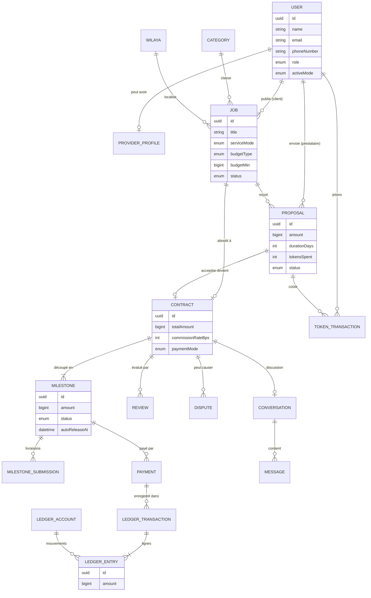

# Talbi — Modèle de données

> **Version** : 0.1
> **Date** : octobre 2026
> **Fichiers** : [`prisma/schema.prisma`](../prisma/schema.prisma) (structure) · [`prisma/sql/constraints.sql`](../prisma/sql/constraints.sql) (règles) · [`prisma/sql/constraints.test.sql`](../prisma/sql/constraints.test.sql) (tests)

---

## 1. À quoi sert ce document

Le modèle de données décrit **ce que Talbi enregistre** (utilisateurs, missions, paiements…) et **les liens entre ces informations**. C'est la fondation de toute l'application : chaque écran lit ou écrit dans ces tables.

Le modèle compte **42 tables**, réparties en 10 domaines :

| # | Domaine | Tables principales |
|---|---|---|
| 1 | Identité et connexion | `users`, `sessions`, `accounts`, `verifications` |
| 2 | Géographie et catalogue | `wilayas`, `communes`, `categories`, `category_fields`, `skills` |
| 3 | Profil prestataire | `provider_profiles`, `provider_skills`, `provider_categories`, `provider_coverages`, `portfolio_items`, `identity_verifications` |
| 4 | Missions et propositions | `jobs`, `job_invitations`, `proposals`, `proposal_milestones` |
| 5 | Contrats et jalons | `contracts`, `milestones`, `milestone_submissions` |
| 6 | Argent | `payments`, `payment_webhook_events`, `payouts`, `ledger_accounts`, `ledger_transactions`, `ledger_entries` |
| 7 | Jetons | `token_packs`, `token_transactions` |
| 8 | Messagerie | `conversations`, `conversation_participants`, `messages` |
| 9 | Confiance | `reviews`, `disputes`, `dispute_messages`, `reports` |
| 10 | Support technique | `file_assets`, `notifications`, `notification_preferences`, `audit_logs`, `platform_settings` |

> **Pourquoi les noms sont en anglais ?** C'est la convention universelle en programmation : tous les outils, bibliothèques et développeurs l'utilisent. La correspondance avec le vocabulaire du cahier des charges est donnée au §9.

---

## 2. Vue d'ensemble

Le schéma ci-dessous montre le **cœur du parcours** : un client publie une mission, un prestataire envoie une proposition, le contrat est découpé en jalons, chaque jalon est payé puis enregistré dans le grand livre.



*(Ce diagramme s'affiche automatiquement sous forme graphique sur GitHub.)*

---

## 3. Les conventions qui protègent les données

| Convention | Exemple | Pourquoi |
|---|---|---|
| **Montants en centimes, nombres entiers** | 1 500,00 DA est stocké `150000` | Les nombres à virgule de l'ordinateur font des erreurs d'arrondi (0,1 + 0,2 ≠ 0,3). Avec des entiers, aucun centime ne se perd. |
| **Pourcentages en points de base** | 10 % est stocké `1000` | Même raison : pas de virgule. |
| **Identifiants UUID** | `3f2b9c1e-…` | Uniques dans le monde entier, impossibles à deviner (on ne peut pas « essayer » `/mission/124` après `/mission/123`). |
| **Valeurs figées à la signature** | Le taux de commission est copié dans le contrat | Si Talbi change sa commission demain, les contrats déjà signés ne sont pas affectés. |
| **Rien n'est supprimé quand il y a de l'argent en jeu** | Un compte supprimé est **anonymisé** (statut `DELETED`) | Les preuves restent disponibles en cas de litige ou de contrôle fiscal, tout en respectant la loi 18-07. |
| **Textes bilingues** | `nameFr` / `nameAr` sur les catégories, wilayas, compétences | Interface en français et en arabe. |

---

## 4. Les domaines en détail

### 4.1 Identité et connexion

- **Un seul compte** (`users`) peut être client **et** prestataire. Le champ `activeMode` mémorise le mode affiché.
- Connexion par **e-mail** ou par **téléphone** (les deux sont uniques), ou par **Google** (table `accounts`).
- `role` distingue les utilisateurs, les modérateurs et les administrateurs.
- `status` permet de suspendre ou bannir un compte sans le supprimer.
- Les tables `sessions`, `accounts` et `verifications` suivent le format de **Better Auth**, l'outil d'authentification retenu (§8.2 du cahier des charges).

### 4.2 Géographie et catalogue

- `wilayas` et `communes` : le découpage administratif officiel, en français et en arabe. L'identifiant d'une wilaya est son **code officiel** (16 = Alger, 31 = Oran…).
- `categories` : arborescence (une catégorie peut avoir des sous-catégories), gérée depuis l'administration.
- `category_fields` : les **champs spécifiques** à chaque catégorie (surface pour la peinture, marque pour l'électroménager…). Ajouter un champ ne demande **aucune modification du code**.

### 4.3 Profil prestataire

- `provider_profiles` : titre, description, mode (à distance / sur place / les deux), langues, disponibilité.
- Compétences, catégories et **wilayas couvertes** sont dans des tables de liaison : c'est ce qui permet de prévenir automatiquement les bons prestataires quand une mission est publiée.
- Les statistiques (note moyenne, missions terminées, taux de réponse) sont **recalculées en arrière-plan** et stockées dans le profil pour un affichage rapide.
- `identity_verifications` : dossier de vérification (pièce d'identité, selfie), examiné par un modérateur. Validé, il active le badge « Vérifié ».

### 4.4 Missions et propositions

- `jobs` : une mission, avec son mode (à distance / sur place), sa localisation, son type de budget (fixe, fourchette, sur devis) et les valeurs de ses champs spécifiques.
- L'**adresse précise** (`privateAddress`) n'est révélée qu'au prestataire retenu.
- `tokenCost` : le nombre de jetons pour proposer est **fixé à la publication**, il ne change pas ensuite.
- `proposals` : **une seule proposition par prestataire et par mission**, garanti par la base de données.
- `proposal_milestones` : le découpage en étapes proposé par le prestataire.

### 4.5 Contrats et jalons

Un contrat est créé quand le client accepte une proposition. Il **copie** les conditions (montant, commission, mode de paiement) : elles ne peuvent plus changer.

**Cycle de vie d'un jalon (paiement en ligne)** :

```
 AWAITING_FUNDING ──(le client paie)──▶ FUNDED ──(le prestataire commence)──▶ IN_PROGRESS
                                                                                  │
                    ┌──────────(corrections demandées)── REVISION_REQUESTED ◀──┐  │
                    ▼                                                          │  ▼
               IN_PROGRESS ─────────────────────────────────────────────▶ SUBMITTED
                                                                              │
                         (le client valide, ou 7 jours sans réponse)          │
                                                                              ▼
                                         RELEASED ◀──(argent versé)── APPROVED

 À tout moment avant la libération : litige → décision d'un modérateur → RELEASED ou REFUNDED
```

Points clés (leçons tirées des projets analysés) :
- En paiement en ligne, le prestataire **ne peut pas commencer** tant que le jalon n'est pas payé.
- Après livraison, **le client ne peut pas se rembourser seul** : seul un litige tranché par un modérateur peut aboutir à `REFUNDED`.
- `autoReleaseAt` : date de libération automatique si le client ne répond pas (7 jours après la livraison).
- Chaque livraison est conservée dans `milestone_submissions` (historique des rendus).

### 4.6 Argent

Voir la section 5, entièrement consacrée à ce sujet.

### 4.7 Jetons

- `token_packs` : les offres d'achat de jetons (ex. : 20 jetons pour 1 000 DA), modifiables depuis l'administration.
- `token_transactions` : chaque gain ou dépense de jetons est une ligne **jamais modifiée** (achat, cadeau de bienvenue, cadeau mensuel, proposition envoyée, remboursement…). Le solde est la somme des lignes.
- La clé d'idempotence empêche qu'un même événement (par exemple un double clic) crédite ou débite deux fois.

### 4.8 Messagerie

- Une `conversation` est liée à une mission (avant contrat) ou à un contrat.
- `conversation_participants` mémorise, pour chaque personne, le dernier message lu (pour afficher « non lu »).
- **Anti-contournement** : si un message contient un numéro de téléphone ou un e-mail avant la signature du contrat, `body` contient la version masquée, `originalBody` la version d'origine (visible uniquement par la modération) et `containsContactInfo` est activé. Cela permet de repérer les utilisateurs qui tentent régulièrement de contourner la plateforme.

### 4.9 Confiance : avis, litiges, signalements

- `reviews` : un avis par personne et par contrat, note de 1 à 5 avec critères détaillés. `publishedAt` gère les **avis à l'aveugle** : l'avis n'est publié que lorsque les deux parties ont noté (ou après 14 jours).
- `disputes` : un litige gèle le jalon concerné. Le modérateur tranche : remboursement du client, paiement du prestataire, ou partage (`SPLIT` avec `refundAmount`).
- `dispute_messages` : échanges et preuves ; `isInternal` permet aux modérateurs de laisser des notes invisibles des parties.
- `reports` : signalement de n'importe quel élément (utilisateur, mission, message…).

### 4.10 Support technique

- `file_assets` : **tous les fichiers** passent par cette table. Chaque fichier a un propriétaire, un usage, une empreinte (SHA-256), un statut d'analyse antivirus et une visibilité. Les fichiers privés (pièces d'identité, reçus) ne sont accessibles que par des **liens temporaires**.
- `notifications` : le contenu est stocké sous forme de données, et le texte est construit au moment de l'affichage **dans la langue de l'utilisateur**.
- `audit_logs` : journal **non modifiable** des actions sensibles (suspension d'un compte, validation d'un retrait…).
- `platform_settings` : réglages modifiables sans toucher au code (taux de commission, délais automatiques, coût des jetons).

---

## 5. L'argent : comment Talbi garantit qu'aucun dinar ne se perd

### 5.1 Trois types d'enregistrements

| Table | Rôle | Exemple |
|---|---|---|
| `payments` | L'argent qui **entre** dans Talbi | Le client paie 10 000 DA par Edahabia pour un jalon |
| `payouts` | L'argent qui **sort** vers un prestataire | Le prestataire retire 5 000 DA vers son CCP |
| Grand livre (`ledger_*`) | **Où se trouve l'argent** à tout instant | 10 000 DA en séquestre, puis 9 000 DA au prestataire et 1 000 DA à Talbi |

### 5.2 Le grand livre en partie double

C'est la méthode utilisée par les banques et les comptables depuis des siècles. **Chaque opération déplace de l'argent d'un compte vers un autre**, et la somme des mouvements est toujours **zéro** : rien ne se crée, rien ne disparaît.

Les comptes de Talbi :

| Compte | Signification |
|---|---|
| `EXTERNAL` | L'extérieur de Talbi (banques, passerelles de paiement) |
| `ESCROW` | L'argent des clients bloqué sous séquestre |
| `PLATFORM_REVENUE` | Les revenus de Talbi |
| `PROVIDER_WALLET` | Le solde disponible de chaque prestataire (un compte par prestataire) |

**Exemple complet** : mission de plomberie à 10 000 DA, commission de 10 %.

| Opération | `EXTERNAL` | `ESCROW` | `PROVIDER_WALLET` | `PLATFORM_REVENUE` | Total |
|---|---:|---:|---:|---:|---:|
| 1. Le client paie le jalon | −10 000 | +10 000 | | | **0** |
| 2. Le client valide → libération | | −10 000 | +9 000 | +1 000 | **0** |
| 3. Le prestataire retire 5 000 DA | +5 000 | | −5 000 | | **0** |
| **Soldes finaux** | −5 000 | 0 | 4 000 | 1 000 | **0** |

Le prestataire a encore 4 000 DA disponibles, Talbi a gagné 1 000 DA, et le séquestre est vide. Le total de tous les comptes vaut **toujours zéro**, ce qui permet de vérifier à tout moment que les comptes sont justes.

### 5.3 Pas de solde stocké à part

Le solde d'un compte n'est **jamais** stocké dans une colonne qu'on modifie : il est **calculé** en additionnant ses lignes du grand livre. Il ne peut donc jamais être faux ni diverger des opérations (c'était une faille du projet WorkStream étudié).

### 5.4 Les protections contre les doubles paiements

- **Clé d'idempotence** sur chaque paiement et chaque opération du grand livre : si le client clique deux fois sur « Payer », ou si la passerelle envoie deux fois la même notification, l'opération n'est enregistrée qu'une fois.
- **Un seul paiement actif par jalon** (en cours ou réussi), garanti par la base.
- `payment_webhook_events` : chaque notification reçue d'une passerelle est enregistrée avec son identifiant unique et traitée **une seule fois**.

---

## 6. Les règles garanties par la base de données

Le code de l'application vérifie déjà ces règles. Mais **un bug finit toujours par arriver** : la base de données les vérifie donc **une seconde fois**, en dernier rempart. Même un développeur qui ferait une erreur, ou un attaquant qui accéderait à la base, ne pourrait pas les contourner.

Ces règles sont dans [`prisma/sql/constraints.sql`](../prisma/sql/constraints.sql).

### 6.1 Règles de l'argent

| Règle | Ce qu'elle empêche |
|---|---|
| Chaque opération du grand livre s'équilibre à zéro | De l'argent créé ou perdu par erreur |
| Les lignes du grand livre ne peuvent être ni modifiées, ni supprimées, ni vidées | La falsification des comptes |
| Un portefeuille ou le séquestre ne passe jamais en négatif | Retirer plus que ce qu'on a ; verser deux fois le même séquestre |
| Deux opérations simultanées sur le même compte sont mises en file d'attente | Vider un portefeuille en envoyant deux retraits au même instant |
| Un seul paiement actif par jalon | Le double paiement |
| Le montant d'un jalon est figé dès qu'il est payé | Changer le prix après coup |
| Les termes d'un contrat (commission, parties, mode de paiement) sont figés | Modifier un accord signé |

### 6.2 Règles de cohérence

| Règle | Ce qu'elle empêche |
|---|---|
| Une mission sur place a obligatoirement une wilaya | Des missions impossibles à attribuer |
| Le budget correspond à son type (fixe, fourchette, sur devis), la fourchette n'est pas inversée | Des budgets incohérents |
| Une seule proposition par prestataire et par mission | Le spam de propositions |
| Le client et le prestataire d'un contrat sont deux personnes différentes | Se payer soi-même pour gonfler sa réputation |
| Une note est comprise entre 1 et 5, on ne peut pas se noter soi-même | Les faux avis |
| Tous les montants sont strictement positifs | Les montants négatifs ou nuls |
| Un fichier est rattaché à un seul élément | Les fuites de fichiers d'un contexte à un autre |

### 6.3 Ces règles sont testées

Le fichier [`prisma/sql/constraints.test.sql`](../prisma/sql/constraints.test.sql) contient **27 tests** qui tentent volontairement de tricher (payer deux fois, retirer plus que le solde, falsifier le grand livre…) et vérifient que **chaque tentative est refusée, pour la bonne raison**. Un test supplémentaire lance **deux retraits exactement au même moment** sur le même portefeuille : un seul est accepté.

Résultat actuel : **tous les tests passent** sur PostgreSQL 16.

```
── Grand livre : équilibre ──
OK  refusé   : opération déséquilibrée (100 sortis, 90 entrés)
OK  accepté  : le client paie le jalon : 10 000 DA bloqués en séquestre
OK  refusé   : enregistrer deux fois la même opération (clé d'idempotence)
OK  accepté  : libération : 9 000 DA au prestataire, 1 000 DA de commission
── Grand livre : soldes jamais négatifs ──
OK  refusé   : libérer une seconde fois un séquestre déjà vide
OK  refusé   : retirer 10 000 DA avec un solde de 9 000 DA
OK  accepté  : retirer 5 000 DA avec un solde de 9 000 DA
…
```

---

## 7. Performance

- **Index** sur toutes les recherches fréquentes : missions publiées par catégorie, par wilaya, par date ; propositions d'un prestataire ; messages d'une conversation ; notifications non lues…
- Les statistiques des prestataires sont **pré-calculées** pour que les pages de recherche restent rapides.
- La recherche plein texte (français, arabe, tolérance aux fautes) sera ajoutée avec le module de recherche, d'abord dans PostgreSQL puis avec Meilisearch (V2).
- À très grande échelle, le calcul des soldes pourra s'appuyer sur des « photos » périodiques des soldes, sans changer le principe du grand livre.

---

## 8. Ce qui reste à faire

- [ ] Intégrer ce schéma et les règles SQL dans la **première migration** lors de la création du projet
- [ ] Données de référence : les **wilayas et communes** officielles, les catégories de départ, les compétences
- [ ] Ajouter les tables propres aux extensions de Better Auth (double authentification) au moment de sa mise en place
- [ ] Recherche plein texte (module recherche)

---

## 9. Correspondance avec le cahier des charges

| Cahier des charges (français) | Code (anglais) |
|---|---|
| Utilisateur | `User` |
| Profil prestataire | `ProviderProfile` |
| Vérification d'identité | `IdentityVerification` |
| Catégorie / Champ spécifique | `Category` / `CategoryField` |
| Compétence | `Skill` |
| Mission | `Job` |
| Invitation | `JobInvitation` |
| Proposition | `Proposal` |
| Contrat | `Contract` |
| Jalon | `Milestone` |
| Livraison | `MilestoneSubmission` |
| Paiement | `Payment` |
| Retrait | `Payout` |
| Grand livre (compte, opération, ligne) | `LedgerAccount`, `LedgerTransaction`, `LedgerEntry` |
| Pack de jetons / Mouvement de jetons | `TokenPack` / `TokenTransaction` |
| Conversation / Message | `Conversation` / `Message` |
| Avis | `Review` |
| Litige | `Dispute` |
| Signalement | `Report` |
| Fichier | `FileAsset` |
| Journal d'administration | `AuditLog` |
| Réglage de la plateforme | `PlatformSetting` |
